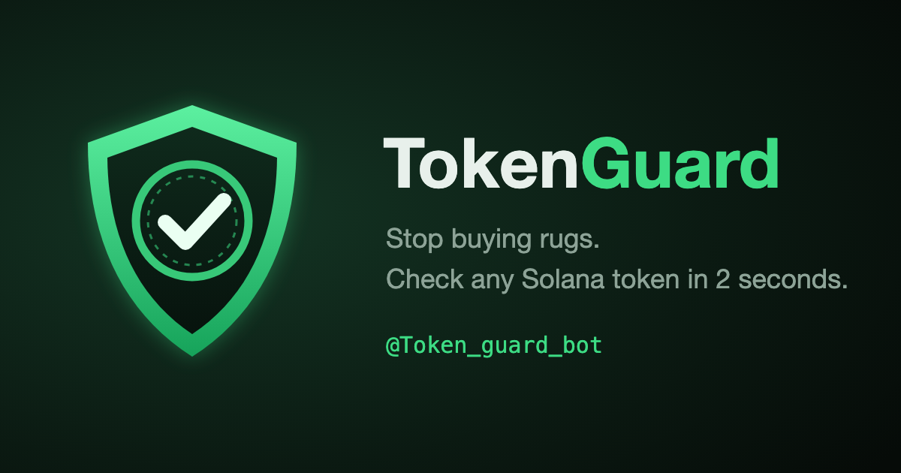

# TokenGuard: check any token before you buy

TokenGuard tells you, **before the purchase**, whether a Solana, BNB Chain or Base token is a trap. It reads the token straight from chain state and answers **SAFE / CAUTION / DANGER** with the reasons, a real sell test and market data.

| Where | Link |
|---|---|
| Telegram bot (private, groups, inline) | https://t.me/Token_guard_bot |
| Telegram Mini App | https://t.me/Token_guard_bot/App |
| Discord app and server | [Add to Discord](https://discord.com/oauth2/authorize?client_id=1562527228292497569) · https://discord.gg/94agSBa3hh |
| Radar channel (rugs caught before they collapsed) | https://t.me/tokenguardradar |
| Website, guides, checked tokens | https://tokenguard-bot.vercel.app |
| Embeddable badge | https://tokenguard-bot.vercel.app/badge/ |

## What it checks
- Freeze, mint, permanent delegate and close authorities; mutable metadata
- Token-2022 traps: transfer hooks, transfer fees, frozen-by-default accounts, pausable mints
- Holder concentration, excluding pools and programs
- **Real sell test**: a buy and a sell are quoted through Jupiter (Solana) or simulated (EVM). No sell route = honeypot proven
- **Creator record**: every token we have seen from the same creator, and how many collapsed
- pump.fun creator behaviour: sold the initial buy, serial launches
- Market data: market cap, liquidity, volume, LP lock

## API
```bash
curl -X POST https://gdzlcxskuhupymyxywzm.supabase.co/functions/v1/tokenguard/keys        # free key, 50 checks a day
curl -H "x-api-key: tg_..." "https://gdzlcxskuhupymyxywzm.supabase.co/functions/v1/tokenguard/v1/check?address=MINT"
```
Examples: [JavaScript](examples/guard.mjs) · [Python](examples/guard.py). Also available pay-per-call over x402 and as an MCP server (`io.github.ryosukedesigner-cmd/tokenguard`).


## Integrations (AI agents and bots)

| Package | For | Folder |
|---|---|---|
| `tokenguard` | any JS/TS bot or backend (no dependencies) | [integrations/tokenguard](integrations/tokenguard) |
| `solana-agent-kit-plugin-tokenguard` | Solana Agent Kit v2 | [integrations/solana-agent-kit-plugin-tokenguard](integrations/solana-agent-kit-plugin-tokenguard) |
| `elizaos-plugin-tokenguard` | elizaOS v1 | [integrations/elizaos-plugin-tokenguard](integrations/elizaos-plugin-tokenguard) |
| `tokenguard-client` (PyPI) | Python bots and backends (standard library only) | [integrations/tokenguard-python](integrations/tokenguard-python) |
| `goat-plugin-tokenguard` | GOAT SDK (Vercel AI, LangChain, OpenAI Agents…) | [integrations/goat-plugin-tokenguard](integrations/goat-plugin-tokenguard) |

Browser extension: https://tokenguard-bot.vercel.app/extension/

## Badge
[](https://tokenguard-bot.vercel.app/badge/)

Automated on-chain risk signals, not financial advice.
